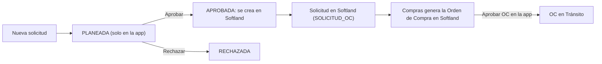
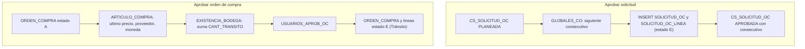

# Manual del Sistema de Compras — Cargotrans

> **Nota para quien convierta este documento a Word (Claude u otro):**
>
> - Convertir este Markdown a un documento Word con estilo formal: portada (título, empresa "Cargotrans", fecha, versión 1.0), índice automático y encabezados numerados.
> - Cada bloque que empieza con **[CAPTURA NN – ...]** debe convertirse en un **cuadro vacío** (recuadro con borde, de unos 15 x 9 cm) con el título de la captura como pie de figura ("Figura NN: ..."). La línea "Qué capturar" **no** debe aparecer en el Word final; solo sirve para quien toma la captura.
> - Las tablas se mantienen como tablas de Word. Los diagramas (bloques `mermaid`) se convierten en un diagrama simple de cajas y flechas o en una lista numerada equivalente.
> - Los bloques de código (comandos, SQL) se muestran con fuente monoespaciada.
> - No inventar contenido adicional.

---

## Control del documento

| Campo | Valor |
| --- | --- |
| Sistema | Módulo de Compras Cargotrans (Solicitudes y Órdenes de Compra) |
| Integración | Softland ERP (SQL Server) |
| Audiencia | Usuarios del módulo (Parte 1), TI (Partes 2 y 3) |
| Versión | 1.0 |

---

# PARTE 1 — MANUAL DE USUARIO

## 1. Introducción

El Módulo de Compras es una aplicación web que permite a los departamentos de Cargotrans **solicitar compras**, que un responsable las **apruebe o rechace**, y que las solicitudes aprobadas queden **registradas automáticamente en Softland**. También permite **consultar y aprobar órdenes de compra** de Softland sin entrar al ERP.

Beneficios principales:

- Las solicitudes se crean desde el navegador (computadora o celular).
- Nada llega a Softland hasta que alguien con permiso la aprueba.
- Se ve cuántos días lleva cada solicitud esperando aprobación.
- Se generan reportes en PDF, Excel o impresión.
- La aprobación de órdenes de compra hace en Softland los mismos movimientos que haría el ERP (costos, cantidades en tránsito, estado).

### 1.1 Flujo general



Resumen en palabras:

1. El usuario crea una **Nueva Solicitud**. Queda en estado **PLANEADA** y todavía no existe en Softland.
2. Un aprobador la revisa en **Historial > Planeadas** y la **aprueba** o la **rechaza**.
3. Al aprobarla, el sistema la registra en Softland con el siguiente consecutivo oficial.
4. El departamento de compras genera la orden de compra en Softland (como siempre).
5. Un usuario con permiso **aprueba la orden de compra** desde la pestaña **Órdenes de Compra**, y la orden pasa a **Tránsito**.

---

## 2. Inicio de sesión

Para entrar se usa **el mismo usuario y contraseña de Softland**. No hay que crear usuarios nuevos.

Pasos:

1. Abrir en el navegador la dirección del sistema que proporcione TI.
2. Escribir el **usuario** de Softland.
3. Escribir la **contraseña**.
4. Presionar **Iniciar Sesión**.

Si la sesión expira (por defecto después de 24 horas), el sistema regresa automáticamente a esta pantalla.

Si el usuario de Softland no tiene ningún permiso asignado (ni registrar, ni aprobar solicitudes, ni aprobar órdenes, ni administrador), después de iniciar sesión ve una pantalla que se lo indica. Desde ahí solo puede cerrar sesión y debe pedir el permiso a un administrador.

> **[CAPTURA 01 – Pantalla de inicio de sesión]**
> Qué capturar: la pantalla de login completa, con el logo y los campos de usuario y contraseña vacíos.

---

## 3. Barra superior y menú de usuario

Después de iniciar sesión se ve la barra superior con:

| Elemento | Para qué sirve |
| --- | --- |
| **Nueva Solicitud** | Crear una solicitud de compra. |
| **Historial** | Ver solicitudes planeadas, aprobadas, rechazadas y las que ya están en Softland. |
| **Órdenes de Compra** | Consultar y aprobar órdenes de compra. **Solo aparece si el usuario tiene el permiso "Aprobar órdenes de compra".** |
| Indicador **Conectado / Sin conexión** | Verde: el servidor responde. Amarillo: no hay comunicación con el servidor (avisar a TI). |
| Menú del usuario (iniciales) | Muestra el nombre del usuario. Contiene **Permisos** (solo administradores) y **Cerrar sesión**. |

> **[CAPTURA 02 – Barra superior]**
> Qué capturar: la barra superior completa, con las tres pestañas visibles y el indicador "Conectado" en verde.

> **[CAPTURA 03 – Menú del usuario abierto]**
> Qué capturar: el menú desplegable del usuario abierto, mostrando el nombre, la opción "Permisos" y "Cerrar Sesión" (usar un usuario administrador).

---

## 4. Nueva Solicitud

Pantalla para crear una solicitud de compra. Requiere el permiso **Registrar solicitudes** (si no se tiene, aparece un aviso y el botón **Crear Solicitud** queda deshabilitado).

### 4.1 Encabezado

| Campo | Obligatorio | Descripción |
| --- | --- | --- |
| **Departamento** | Sí | Departamento que solicita. Se elige de la lista de departamentos de Softland. |
| **Gerencia** | No | Se llena automáticamente con la descripción del departamento; se puede modificar. |
| **Fecha Solicitud** | No | Por defecto, la fecha de hoy. |
| **Fecha Requerida** | Sí | Fecha en la que se necesita lo solicitado. |
| **Prioridad** | No | Alta, Media o Baja. |
| **Comentario** | No | Observaciones generales de la solicitud. |
| **Rubros 1 a 5** | No | Campos adicionales. Sus nombres se toman de la configuración de Softland. |

En la parte superior se indica "Se asigna consecutivo Softland al aprobar": la solicitud no tiene número de Softland hasta que se aprueba.

> **[CAPTURA 04 – Nueva Solicitud, encabezado]**
> Qué capturar: la parte superior del formulario con Departamento seleccionado, Gerencia autollenada, fechas y prioridad.

### 4.2 Líneas de la solicitud

Cada línea es un artículo a comprar:

| Campo | Obligatorio | Descripción |
| --- | --- | --- |
| **Artículo** | Sí | Buscador de artículos de Softland (por código o descripción). |
| **Cantidad** | Sí | Cantidad a solicitar. |
| **Saldo** | — | Informativo. |
| **Número de parte / especificación** | No | Detalle técnico del artículo. |
| **Comentario línea** | No | Observación de esa línea. |

Se pueden agregar varias líneas y eliminar las que no se necesiten. El centro de costo no se pide: se envía vacío.

> **[CAPTURA 05 – Nueva Solicitud, líneas]**
> Qué capturar: la sección "Líneas de Solicitud" con dos o tres artículos agregados y el buscador de artículos abierto en una de ellas.

### 4.3 Guardar

1. Revisar los datos.
2. Presionar **Crear Solicitud**.
3. Aparece un mensaje de confirmación y el sistema lleva al **Historial**, donde la solicitud aparece como **PLANEADA**.

> **[CAPTURA 06 – Solicitud guardada]**
> Qué capturar: el mensaje verde de confirmación después de guardar (esquina de la pantalla) y el Historial con la nueva solicitud en la lista.

### 4.4 Editar una solicitud planeada

Mientras la solicitud está **PLANEADA** se puede corregir: en el detalle de la solicitud (Historial > Planeadas) se presiona **Editar**, se abre el mismo formulario con los datos cargados ("Editar solicitud #N"), se corrige y se presiona **Actualizar Solicitud** (o **Cancelar edición** para descartar). Una vez aprobada o rechazada ya no se puede editar.

> **[CAPTURA 07 – Editar solicitud]**
> Qué capturar: el formulario en modo edición, mostrando el título "Editar solicitud #N".

---

## 5. Historial — pestaña Planeadas

Aquí se gestionan las solicitudes creadas en la aplicación antes y después de su aprobación.

**Qué solicitudes ve cada usuario:** cada usuario ve **solo las solicitudes que él creó** (aparece el aviso "Mostrando solo tus solicitudes"). Los usuarios con permiso **Administrador** o **Aprobar solicitudes** ven las de todos.

### 5.1 Lista y filtros

- **Filtro rápido de estado:** Planeada, Aprobada, Rechazada (se pueden combinar). Por defecto muestra las planeadas.
- **Filtros avanzados:** Ref. (número interno), consecutivo Softland, Departamento, rango de Fecha solicitud y rango de Fecha requerida.
- Columnas: Ref., Estado, Departamento, F. solicitud, **Días**, Softland (consecutivo asignado al aprobar) y Acción.

> **[CAPTURA 08 – Planeadas, lista]**
> Qué capturar: la tabla de Planeadas con varias solicitudes, idealmente con distintos colores en la columna "Días" y los botones Aprobar/Rechazar visibles.

> **[CAPTURA 09 – Planeadas, filtros]**
> Qué capturar: el panel de filtros abierto, con algún filtro aplicado (por ejemplo, estado Aprobada y un rango de fechas).

### 5.2 Columna "Días"

Indica cuánto tiempo lleva o tardó la aprobación, en **días calendario** (hora de Nicaragua):

| Estado | Texto que se muestra | Significado |
| --- | --- | --- |
| Planeada | "Hoy" o "En espera: N días" | Días desde que se creó hasta hoy. |
| Aprobada | "Aprobada en N días" | Días que tardó en aprobarse. |
| Rechazada | "Rechazada en N días" | Días que tardó en rechazarse. |

Colores para solicitudes **planeadas**:

| Color | Días en espera |
| --- | --- |
| Gris | 0 a 2 días |
| Ámbar | 3 a 6 días |
| Rojo | 7 días o más |

> **[CAPTURA 10 – Columna Días con colores]**
> Qué capturar: un acercamiento a la columna "Días" mostrando al menos una solicitud en gris, una en ámbar y una en rojo.

### 5.3 Detalle de la solicitud

Al hacer clic en una fila se abre el detalle: departamento, gerencia, solicitante, fecha de solicitud, **días en espera** (o **tiempo de aprobación**), fecha requerida, consecutivo Softland (si ya se aprobó), fecha de aprobación o rechazo, motivo de rechazo y las líneas.

> **[CAPTURA 11 – Detalle de una solicitud planeada]**
> Qué capturar: el panel de detalle de una solicitud PLANEADA, mostrando "Días en espera" y los botones Editar, Rechazar y Aprobar.

### 5.4 Aprobar una solicitud

Requiere el permiso **Aprobar solicitudes**.

1. Presionar **Aprobar** (en la fila o en el detalle).
2. Aparece la confirmación: "¿Enviar la solicitud #N a Softland? Quedará registrada en el ERP."
3. Presionar **Aprobar y enviar**.
4. El sistema muestra "Aprobando y enviando a Softland" y luego el mensaje **"Aprobada en Softland: SOLxxxxx"** con el consecutivo asignado.
5. La solicitud pasa a **APROBADA** y en la columna Softland aparece su consecutivo.

> **[CAPTURA 12 – Confirmación de aprobación]**
> Qué capturar: el cuadro de confirmación "Aprobar solicitud" con el botón "Aprobar y enviar".

> **[CAPTURA 13 – Mensaje "Aprobada en Softland"]**
> Qué capturar: el mensaje verde con el consecutivo Softland asignado, y la fila de la solicitud ya en estado APROBADA.

> **[CAPTURA 14 – Detalle de una solicitud aprobada]**
> Qué capturar: el detalle de una solicitud APROBADA, mostrando "Tiempo de aprobación", "Fecha aprobación" y el consecutivo Softland.

### 5.5 Rechazar una solicitud

Requiere el permiso **Aprobar solicitudes**.

1. Presionar **Rechazar**.
2. Escribir el **motivo de rechazo** (opcional, pero recomendado).
3. Confirmar.
4. La solicitud pasa a **RECHAZADA** y **no se envía a Softland**. El motivo queda visible en el detalle.

> **[CAPTURA 15 – Cuadro de rechazo]**
> Qué capturar: el cuadro "Rechazar solicitud" con un motivo escrito.

---

## 6. Historial — pestaña En Softland

Muestra las solicitudes **tal como están en Softland** (tabla de solicitudes del ERP), incluidas las creadas por esta aplicación y las creadas directamente en Softland. Aplica la misma regla que en Planeadas: cada usuario ve solo las suyas (las que tienen su usuario en Softland), y los administradores y aprobadores ven todas.

- Estados de Softland: **Planeada**, **No Asignada**, **Asignada**, **Cancelada**.
- Filtros por número de solicitud, departamento, estado y fechas.
- Detalle con: departamento, fechas, usuario, aprobado por, fecha de aprobación, cancelación, rubros y líneas.
- **Reportes** desde el detalle: **Imprimir**, **PDF** y **Excel**.

> **[CAPTURA 16 – Pestaña En Softland]**
> Qué capturar: la lista de solicitudes de Softland con la pestaña "En Softland" seleccionada.

> **[CAPTURA 17 – Detalle Softland con botones de reporte]**
> Qué capturar: el detalle de una solicitud de Softland, mostrando los botones Imprimir, PDF y Excel.

> **[CAPTURA 18 – Reporte PDF generado]**
> Qué capturar: el PDF de una solicitud abierto (o la vista de impresión).

---

## 7. Órdenes de Compra

Visible solo para usuarios con el permiso **Aprobar órdenes de compra**. Las órdenes se crean en Softland; aquí se **consultan y aprueban**.

### 7.1 Lista y filtros

- Filtro rápido por estado: Planeada, Tránsito, Backorder, No aprobada, Cancelada, Por aprobar, Recibida.
- Búsqueda libre, rango de número de orden y rango de fechas.
- Cada fila muestra orden, proveedor, fecha, estado, total y el botón **Aprobar** (solo en órdenes **Planeadas**).

> **[CAPTURA 19 – Órdenes de Compra, lista]**
> Qué capturar: la lista de órdenes con el filtro "Planeada" activo y el botón Aprobar visible.

### 7.2 Detalle

Muestra proveedor, bodega, fechas, departamento, condición de pago, moneda, usuario, totales (mercadería, impuesto, total a comprar), instrucciones/observaciones y la tabla de **líneas** (artículo, bodega, cantidad, precio, impuesto).

> **[CAPTURA 20 – Detalle de una orden de compra]**
> Qué capturar: el detalle de una orden Planeada con sus líneas y totales.

### 7.3 Aprobar una orden de compra

1. Presionar **Aprobar** (en la fila o en el detalle).
2. Confirmar en el cuadro "Aprobar orden de compra" (indica que la orden pasará a Tránsito y se actualizarán cantidades).
3. La orden pasa de **Planeada** a **Tránsito**, y en el detalle aparecen "Aprobada por" y "Fecha aprobación".

> **[CAPTURA 21 – Confirmación de aprobación de OC]**
> Qué capturar: el cuadro de confirmación "Aprobar orden de compra".

> **[CAPTURA 22 – Orden en Tránsito]**
> Qué capturar: la misma orden después de aprobada, con estado "Tránsito", "Aprobada por" y "Fecha aprobación".

---

## 8. Permisos (solo administradores)

Desde el menú del usuario > **Permisos** se abre la matriz de permisos. Lista todos los usuarios de Softland y permite activar o desactivar:

| Permiso | Qué permite |
| --- | --- |
| **Administrador** | Gestionar permisos y ver las solicitudes de todos los usuarios. Al activarlo se activan también los otros tres. |
| **Registrar solicitudes** | Crear y editar sus propias solicitudes de compra (solo ve las suyas). |
| **Aprobar solicitudes** | Ver las solicitudes de todos los usuarios y aprobarlas o rechazarlas (incluye registrar). |
| **Aprobar órdenes de compra** | Ver la pestaña Órdenes de Compra y aprobarlas. |

Cada cambio pide confirmación. Reglas de seguridad: solo un administrador puede cambiar permisos, y **no se puede quitar el último administrador activo**.

> **[CAPTURA 23 – Matriz de permisos]**
> Qué capturar: la ventana de Permisos con varios usuarios y casillas marcadas; usar el buscador para mostrar cómo se filtra.

> **[CAPTURA 24 – Confirmación de cambio de permiso]**
> Qué capturar: el cuadro de confirmación que aparece al marcar o desmarcar un permiso.

---

## 9. Uso desde el celular

La aplicación se adapta a pantallas pequeñas: las tablas se convierten en **tarjetas** con los datos principales (incluida la columna Días) y los botones de acción. Las pestañas se muestran con nombres cortos (Nueva, Historial, OC).

> **[CAPTURA 25 – Vista en celular]**
> Qué capturar: la pestaña Planeadas en un celular (o en el navegador en modo celular), mostrando las tarjetas.

---

# PARTE 2 — INTEGRACIÓN CON SOFTLAND

## 10. Cómo se integra con Softland

La aplicación trabaja **directamente sobre la base de datos SQL Server de Softland**, en el mismo esquema de la compañía (configurado por TI). No hay archivos intermedios ni procesos nocturnos: los cambios se ven en Softland al instante.

### 10.1 Tablas que usa

**Tablas propias de la aplicación** (se crean solas al iniciar el servidor, salvo la de permisos):

| Tabla | Contenido |
| --- | --- |
| `CS_SOLICITUD_OC` | Encabezado de las solicitudes creadas en la app (estado, días, aprobación, gerencia `U_GERENCIA`, consecutivo Softland asignado). |
| `CS_SOLICITUD_OC_LINEA` | Líneas de esas solicitudes. |
| `CS_PERMISO_USUARIO` | Permisos de cada usuario (se crea con el script `cs_erp_server/mapeo/cs_permiso_usuario.sql`). |

**Tablas de Softland que solo se leen:**

| Tabla | Uso |
| --- | --- |
| `ERPADMIN.USUARIO` | Usuarios y contraseñas para iniciar sesión. |
| `DEPARTAMENTO` | Lista de departamentos. |
| `ARTICULO` | Catálogo de artículos. |
| `GLOBALES_CO` | Configuración de compras (nombres de rubros). |
| `PROVEEDOR` | Nombre del proveedor en las órdenes de compra. |

**Tablas de Softland que se escriben:**

| Tabla | Cuándo |
| --- | --- |
| `GLOBALES_CO` (`ULT_SOLICITUD`) | Al aprobar una solicitud (toma el siguiente consecutivo). |
| `SOLICITUD_OC`, `SOLICITUD_OC_LINEA` | Al aprobar una solicitud. |
| `ORDEN_COMPRA`, `ORDEN_COMPRA_LINEA` | Al aprobar una orden de compra. |
| `ARTICULO_COMPRA` | Al aprobar una orden de compra. |
| `EXISTENCIA_BODEGA` | Al aprobar una orden de compra. |
| `USUARIOS_APROB_OC` | Al aprobar una orden de compra. |

### 10.2 Al aprobar una solicitud de compra

1. Se toma el **siguiente consecutivo** de `GLOBALES_CO.ULT_SOLICITUD`, con bloqueo para que dos aprobaciones simultáneas no obtengan el mismo número.
2. Se inserta la solicitud en `SOLICITUD_OC` y sus líneas en `SOLICITUD_OC_LINEA`, con estado **E (No Asignada)**, **autorizada por** el usuario que aprobó y la **fecha de autorización**.
3. La solicitud en `CS_SOLICITUD_OC` queda **APROBADA**, con el consecutivo Softland, el usuario y la fecha de aprobación.

Los pasos 1 y 2 ocurren en **una sola transacción**: si algo falla, no se consume el consecutivo ni queda nada a medias en Softland.

Al **rechazar**, no se toca Softland; solo cambia el estado en `CS_SOLICITUD_OC`.

### 10.3 Al aprobar una orden de compra

Reproduce lo que hace Softland al confirmar una orden:

1. Verifica que la orden esté en estado **A (Planeada)** y la bloquea mientras se procesa.
2. Por cada línea:
   - En `ARTICULO_COMPRA` actualiza último precio unitario, último proveedor, última moneda y fecha de última cotización.
   - En `EXISTENCIA_BODEGA` suma la cantidad ordenada a **`CANT_TRANSITO`** del artículo en su bodega.
3. Registra al aprobador en `USUARIOS_APROB_OC` (si no estaba).
4. En `ORDEN_COMPRA` marca **confirmada = S**, el usuario que confirma, la fecha y hora, y cambia el estado a **E (Tránsito)**. Las líneas en estado A pasan a **E**.

Todo ocurre en **una sola transacción**: o se aplica completo, o no se aplica nada.

### 10.4 Diagrama de las dos rutas



> **[CAPTURA 26 – (Opcional, TI) Solicitud en Softland]**
> Qué capturar: la solicitud aprobada abierta en Softland (o una consulta a `SOLICITUD_OC` en SQL) mostrando el mismo consecutivo que dio la aplicación.

> **[CAPTURA 27 – (Opcional, TI) Orden de compra en Softland después de aprobar]**
> Qué capturar: la orden aprobada en Softland mostrando estado Tránsito y el usuario que confirma.

---

# PARTE 3 — GUÍA PARA TI

## 11. Arquitectura

| Componente | Tecnología | Carpeta | Puerto típico |
| --- | --- | --- | --- |
| Interfaz web | Next.js | `cs_erp_frontend` | 3000 |
| API | NestJS (Node.js 20) | `cs_erp_server` | 7500 |
| Base de datos | SQL Server de Softland | — | 1433 |

Flujo: **Navegador → (IIS proxy HTTPS) → Web / API → SQL Server**.

- **Autenticación:** usuario y contraseña de Softland (`ERPADMIN.USUARIO`). El API entrega un token JWT en una **cookie**; todas las rutas del API están protegidas excepto el inicio de sesión.
- **Permisos:** tabla `CS_PERMISO_USUARIO`, validados en el servidor en cada acción (no solo en la pantalla).

La instalación detallada (servidor, servicios de Windows, IIS) está en:

- `docs/MANUAL_INSTALACION_TI.md`
- `docs/IIS_PROXY.md`

## 12. Variables de entorno

### 12.1 API (`cs_erp_server/.env`)

| Variable | Descripción |
| --- | --- |
| `DATABASE_HOST` | Servidor SQL de Softland. |
| `DATABASE_PORT` | Puerto SQL (normalmente 1433). |
| `DATABASE_USER` / `DATABASE_PASSWORD` | Usuario SQL con permisos de lectura/escritura en las tablas listadas en la sección 10.1. |
| `DATABASE_NAME` | Base de datos de Softland. |
| `DATABASE_SCHEMA` | Esquema de la compañía (por ejemplo `POSCS`). |
| `DATABASE_ENCRYPT` | `true` si el SQL Server exige conexión cifrada. |
| `CS_SYNC_TABLES` | `true` (por defecto): crea/actualiza automáticamente las tablas `CS_SOLICITUD_OC*`. Poner `false` si el DBA prefiere controlarlas. |
| `SERVER_PORT` | Puerto del API (por defecto 7500). |
| `NODE_ENV` | `production` en el servidor. |
| `JWT_SECRET` | Cadena secreta larga y aleatoria. **Obligatorio cambiarla** en producción. |
| `EXPIRES_IN` | Duración de la sesión (por defecto `24h`). |
| `CORS_ADDITIONAL_ORIGIN` | URL pública exacta de la web (sin barra final). |
| `SOFTLAND_DECRYPT_EXE_PATH` / `SOFTLAND_DECRYPT_KEY` / `SOFTLAND_DECRYPT_TIMEOUT_MS` | Configuración del validador de contraseñas de Softland (si aplica). |

### 12.2 Web (`cs_erp_frontend`)

| Variable | Descripción |
| --- | --- |
| `NEXT_PUBLIC_BACKEND_API_URL` | URL del API. **No se usa** cuando IIS hace de proxy (recomendado). |
| `API_DEV_PROXY_TARGET` | Solo desarrollo: a dónde reenviar las llamadas al API (por defecto `http://127.0.0.1:7500`). |

## 13. Instalación y arranque (resumen)

1. **Base de datos (una sola vez):** ejecutar `cs_erp_server/mapeo/cs_permiso_usuario.sql` en el SQL Server (ajustar `USE` y `@Schema` a la compañía). Crea `CS_PERMISO_USUARIO` y deja al usuario **ERPADMIN** como primer administrador.
2. **API:**
   ```bat
   cd C:\Apps\CS_SolicitudCompra\api
   npm ci --omit=dev
   npm run start:prod
   ```
   Al iniciar crea automáticamente `CS_SOLICITUD_OC`, `CS_SOLICITUD_OC_LINEA` y la columna `U_GERENCIA` si no existen.
3. **Web:**
   ```bat
   cd C:\Apps\CS_SolicitudCompra\web
   npm ci --omit=dev
   npm run start
   ```
4. **Orden de arranque:** primero el API, luego la web.
5. Configurar ambos como **servicios de Windows** y el **proxy IIS** según los documentos de la sección 11.

> **[CAPTURA 28 – (TI) API iniciado]**
> Qué capturar: la consola o el log del servicio del API iniciado sin errores, mostrando el puerto.

## 14. Primer uso

1. Iniciar sesión con **ERPADMIN** (o el usuario administrador definido en el script).
2. Menú del usuario > **Permisos**.
3. Asignar a cada usuario los permisos que le correspondan (ver sección 8).
4. Recomendado: dejar al menos **dos administradores** activos.

## 15. Seguridad

- Todas las consultas a la base de datos son **parametrizadas** (protegidas contra inyección SQL).
- Todas las rutas del API requieren sesión válida; cada acción valida el permiso en el servidor.
- Las aprobaciones usan **transacciones y bloqueos** de fila para evitar consecutivos duplicados o datos a medias.
- La sesión viaja en una cookie; usar **HTTPS** en producción.
- No exponer SQL Server ni el puerto del API a Internet.

## 16. Solución de problemas

| Síntoma | Causa probable | Qué revisar |
| --- | --- | --- |
| Indicador **"Sin conexión"** | El API no está corriendo o el proxy no lo alcanza. | Servicio del API, puerto `SERVER_PORT`, reglas de IIS. |
| Regresa al login constantemente | Sesión expirada o cookie bloqueada. | `EXPIRES_IN`, HTTPS, que web y API se sirvan por el mismo dominio (proxy IIS). |
| Error de CORS en el navegador | La URL pública no coincide. | `CORS_ADDITIONAL_ORIGIN` igual a la URL exacta de la web. |
| No puede iniciar sesión | Usuario/contraseña de Softland, o validador de contraseñas. | Usuario activo en Softland; variables `SOFTLAND_DECRYPT_*`. |
| Error al aprobar una solicitud | Problema con el consecutivo o un bloqueo en `GLOBALES_CO`. | Log del API; que `GLOBALES_CO.ULT_SOLICITUD` tenga formato válido; transacciones abiertas en SQL. La operación se revierte completa, se puede reintentar. |
| Error al aprobar una OC | La orden ya no está Planeada (alguien la aprobó o cambió en Softland) o un bloqueo en la base de datos. | Estado de la orden en Softland; log del API. La operación se revierte completa. |
| La OC se aprobó pero `CANT_TRANSITO` no cambió | El artículo no tiene registro en `EXISTENCIA_BODEGA` para esa bodega (el sistema no crea el registro). | Revisar la existencia del artículo en la bodega de la línea en Softland. |
| Usuario no ve **Órdenes de Compra** | No tiene el permiso. | Asignar "Aprobar órdenes de compra" en Permisos. |
| Usuario no puede guardar solicitudes | No tiene el permiso. | Asignar "Registrar solicitudes". |
| No aparece la opción **Permisos** | El usuario no es administrador. | Asignar Administrador desde otro admin, o por SQL en `CS_PERMISO_USUARIO`. |

**Logs:** el API escribe en la consola del proceso (o en el archivo de log configurado en el servicio de Windows: NSSM/PM2). La web también registra errores en su consola.

---

# ANEXO — LISTA DE CAPTURAS A TOMAR

Marcar cada una al tomarla. Guardarlas con el número como nombre (por ejemplo `captura_01.png`) para pegarlas fácilmente en el Word.

| # | Captura | Sección |
| --- | --- | --- |
| [ ] 01 | Pantalla de inicio de sesión | 2 |
| [ ] 02 | Barra superior con las tres pestañas y "Conectado" | 3 |
| [ ] 03 | Menú del usuario abierto (con Permisos) | 3 |
| [ ] 04 | Nueva Solicitud, encabezado lleno | 4.1 |
| [ ] 05 | Nueva Solicitud, líneas con artículos | 4.2 |
| [ ] 06 | Mensaje de solicitud guardada | 4.3 |
| [ ] 07 | Formulario en modo "Editar solicitud #N" | 4.4 |
| [ ] 08 | Planeadas, lista con columna Días y botones | 5.1 |
| [ ] 09 | Planeadas, filtros abiertos | 5.1 |
| [ ] 10 | Columna Días en gris, ámbar y rojo | 5.2 |
| [ ] 11 | Detalle de solicitud planeada | 5.3 |
| [ ] 12 | Confirmación "Aprobar solicitud" | 5.4 |
| [ ] 13 | Mensaje "Aprobada en Softland: ..." | 5.4 |
| [ ] 14 | Detalle de solicitud aprobada | 5.4 |
| [ ] 15 | Cuadro "Rechazar solicitud" con motivo | 5.5 |
| [ ] 16 | Pestaña En Softland, lista | 6 |
| [ ] 17 | Detalle Softland con Imprimir/PDF/Excel | 6 |
| [ ] 18 | PDF o vista de impresión | 6 |
| [ ] 19 | Órdenes de Compra, lista filtrada en Planeada | 7.1 |
| [ ] 20 | Detalle de orden de compra | 7.2 |
| [ ] 21 | Confirmación "Aprobar orden de compra" | 7.3 |
| [ ] 22 | Orden en estado Tránsito | 7.3 |
| [ ] 23 | Matriz de permisos | 8 |
| [ ] 24 | Confirmación de cambio de permiso | 8 |
| [ ] 25 | Vista en celular (tarjetas) | 9 |
| [ ] 26 | (Opcional TI) Solicitud en Softland | 10.4 |
| [ ] 27 | (Opcional TI) OC en Softland después de aprobar | 10.4 |
| [ ] 28 | (TI) Consola del API iniciado | 13 |

**Consejos para las capturas:**

- Usar datos de prueba o datos reales sin información sensible.
- Tomar las capturas a pantalla completa del navegador, sin otras pestañas visibles.
- Para las capturas 12, 13, 21 y 22 hace falta aprobar algo de verdad: hacerlo en un ambiente de pruebas o con una solicitud/orden que realmente deba aprobarse.
